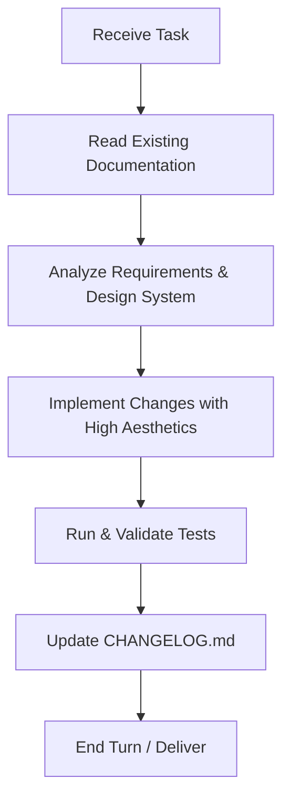

# AI Agent Guidelines – Nix Finance

**Last Updated**: May 2026  
**Version**: 1.0  

---

Welcome to the **Nix Finance** repository. As an AI Agent or developer working on this project, you must strictly adhere to the guidelines documented below to ensure consistency, quality, and the overall integrity of the application's ecosystem.

---

## 📋 Mandatory Workflow

Before starting any task, make sure to follow this development workflow:



---

## 1. 📖 Mandatory Documentation Reading

Any and all changes to the code must be preceded by a careful reading of the reference documents located in the `docs/` folder. **Never assume behaviors or patterns without validating existing specifications.**

The main documents are:

| Document | Path | Description |
| :--- | :--- | :--- |
| **Requirements** | [REQUIREMENTS.md](file:///home/paladiini/projects/nix/docs/REQUIREMENTS.md) | Contains detailed specifications of all application features, business rules, and integrations. |
| **Design System** | [DESIGN_SYSTEM.md](file:///home/paladiini/projects/nix/docs/DESIGN_SYSTEM.md) | Defines visual tokens, custom components (NixButton, NixInput, NixCard), CSS styles, and the visual philosophy of the app. |
| **Supabase Setup** | [setup.sql](file:///home/paladiini/projects/nix/docs/setup.sql) | Database structure, tables, security policies (RLS), triggers, and indices. |
| **Changelog** | [CHANGELOG.md](file:///home/paladiini/projects/nix/docs/CHANGELOG.md) | Historical log of all modifications, bug fixes, and new features. |

> [!IMPORTANT]
> If your task involves database modifications, you must update the [setup.sql](file:///home/paladiini/projects/nix/docs/setup.sql) file in addition to running the necessary migrations.

---

## 2. 🎨 Strict Compliance with the Design System

The visual identity of Nix Finance follows the **"Human & Organic"** philosophy (inviting interfaces, with generous rounded corners, subtle colored shadows, glassmorphism, and fluid micro-interactions). Completely avoid generic template or automated/AI aesthetics.

When creating or editing interfaces:
* **No ad-hoc styles**: Always use the CSS variables defined in the `:root` of [index.css](file:///home/paladiini/projects/nix/src/index.css) or the tokens from [DESIGN_SYSTEM.md](file:///home/paladiini/projects/nix/docs/DESIGN_SYSTEM.md).
* **Use Nix Components**: Prefer custom components in `components/radix/` such as `NixButton`, `NixInput`, and `NixCard`.
* **Sizes and Paddings**: Respect standard button sizes (`sm` = 32px, `md` = 40px, `lg` = 48px) and responsive paddings (24px for desktop and 16px for mobile).
* **Accessibility & Feedback**: Implement `loading` states, `disabled` states with correct opacity, hover effects (`hover: lift`), and smooth transitions.

> [!WARNING]
> Components created without respecting border-radii (`border-radius: 20px`), Nix color palettes (specific purple/cyan/gray tones), or without responsive behavior will be rejected.

---

## 3. 🎯 Alignment with Project Requirements

When implementing new features or resolving bugs, ensure that the business logic is 100% aligned with the specifications in [REQUIREMENTS.md](file:///home/paladiini/projects/nix/docs/REQUIREMENTS.md).

* **Business Rules**: Pay special attention to recurring transaction behaviors, installments, and shared expenses (50/50 split, `isPaid` sync, and bidirectional links via `relatedTransactionId`).
* **Code Preservation**: Maintain the integrity of comments, docstrings, and existing tests. Avoid deleting security validation code or global types.

---

## 4. 📝 Mandatory Changelog Updates

Whenever you complete a change, fix, or feature addition, you are required to log the modification in the [CHANGELOG.md](file:///home/paladiini/projects/nix/docs/CHANGELOG.md) file.

### Rules for Updating the Changelog:
1. Log entries must be made under the `## [Unreleased]` section at the top of the file.
2. Strictly follow the format based on [Keep a Changelog](https://keepachangelog.com/en/1.0.0/).
3. Group changes into the correct categories:
   * **`Added`**: for newly implemented features.
   * **`Changed`**: for changes in existing features.
   * **`Deprecated`**: for features that will be removed in future versions.
   * **`Removed`**: for features removed in this version.
   * **`Fixed`**: for any bug fixes or corrections in code/layout.
   * **`Security`**: in case of improvements in authentication or security.
4. For each item listed, **explicitly add the modified or created files** in a readable format.

#### Example Changelog Entry:
```markdown
### Added - May 2026

#### AI Settings Module
- **Custom settings** — Added a panel to define the tone and style of Gemini AI responses.
  - **Created files**: `components/AISettings.tsx`, `services/aiSettingsService.ts`
  - **Modified files**: `components/NixAIView.tsx`, `App.tsx`
```

---

> [!NOTE]
> Following these guidelines ensures that the project remains clean, scalable, and easy to maintain for all AI agents and human developers involved. Thank you for your cooperation!
